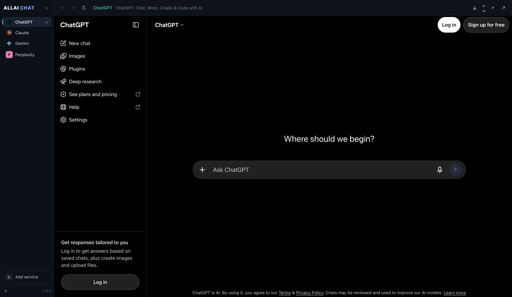
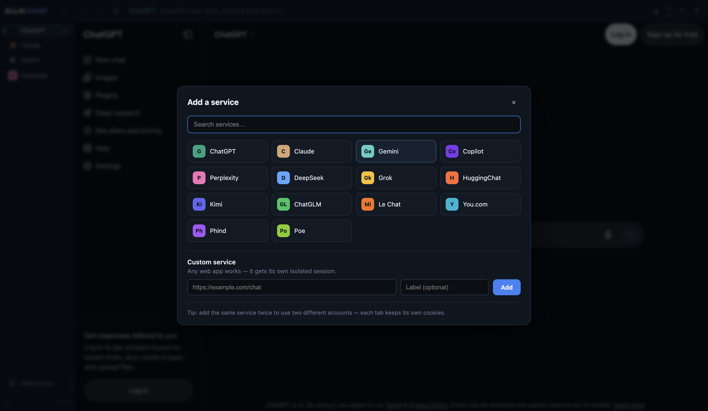
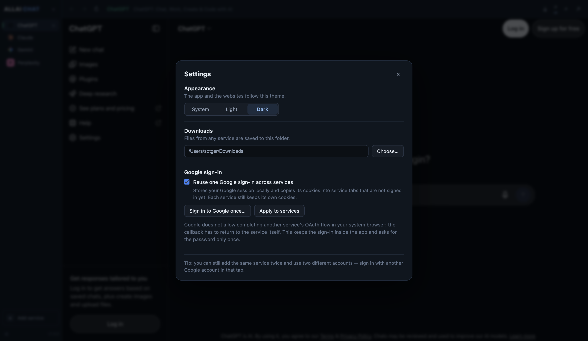
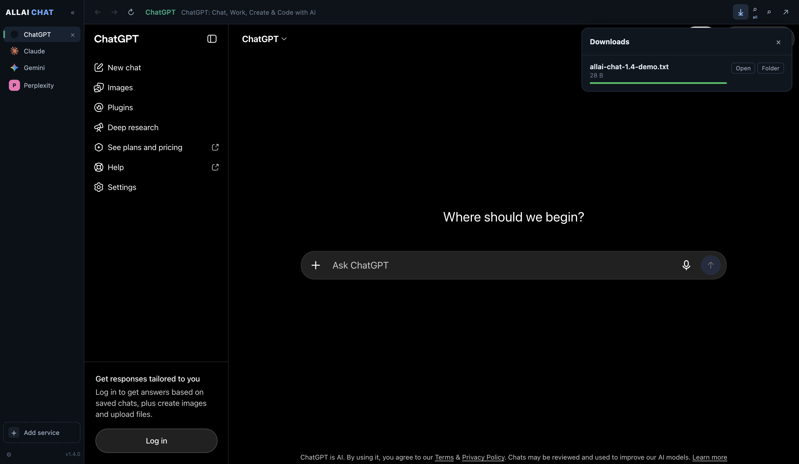
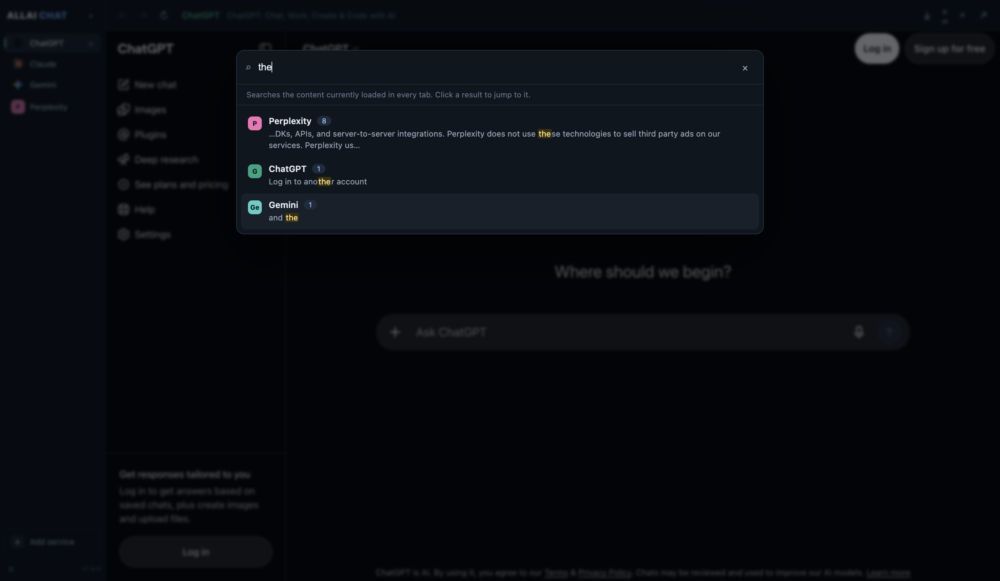

# ALLAI-CHAT

[](https://github.com/sotger/allai-chat/actions/workflows/ci.yml)
[](https://github.com/sotger/allai-chat/releases/latest)
[](LICENSE)

**All your AI chats in one desktop app.** ALLAI-CHAT is a small Electron browser
for ChatGPT, Claude, Gemini, Copilot, Perplexity, DeepSeek, Grok and other AI
services. Each service lives in a vertical tab with its own isolated profile, so
you can stay signed in to several accounts without mixing cookies.

You do not need API keys, and nothing is proxied through a third-party server:
the app simply loads the real AI websites, like a dedicated browser with
profiles.

## Screenshots











## Features

- **Vertical tabs** — one tab per AI service, drag to reorder, double-click to
  rename, switch instantly with the sidebar or `Cmd/Ctrl+1…9`. The sidebar is
  compact by default and collapses to a 64 px icon rail with one click.
- **Isolated sessions** — every tab runs in its own Electron partition with its
  own cookies and storage. Add the same service twice to use two accounts.
- **Google and Microsoft sign-in work** — sign-in popups are real browser
  popups that share the tab's session, so OAuth callbacks and `window.opener`
  messaging work. Grok, Claude and Clerk-based services return to the app
  correctly after login.
- **One Google sign-in for all services** — optionally store a Google session
  once and reuse it in new tabs, while every service keeps its own cookies.
  Useful when the same Google account is used everywhere. Can be disabled in
  **Settings → Google sign-in**.
- **Downloads** — files go to `~/Downloads` by default, or to a folder chosen in
  **Settings → Downloads**. A browser-style download button in the top bar shows
  progress, lets you cancel a transfer, open the file or reveal it in Finder /
  Explorer.
- **System light and dark themes** — the window follows the OS by default; you
  can force light or dark in **Settings → Appearance**. Websites receive the
  same `prefers-color-scheme` value.
- **Tabs stay loaded** — no reload when switching; audio from inactive tabs is
  muted automatically.
- **Search across services** — `Cmd/Ctrl+Shift+F` searches the loaded content of
  every tab, shows match counts and a snippet, and jumps to the right service on
  click. (Loaded pages only — it is not an index of remote chat history.)
- **Browser basics** — back / forward / reload, find in page, zoom, downloads,
  native context menu with Cut / Copy / Paste, camera and microphone support.
- **Persistent workspace** — tabs, order, active tab, labels and window size are
  restored on the next launch.
- **No telemetry** — no analytics, no accounts, no cloud sync. The app only
  talks to the services you open and checks GitHub Releases for updates.

Included services: ChatGPT, Claude, Gemini, Copilot, Perplexity, DeepSeek, Grok,
HuggingChat, Kimi, ChatGLM, Le Chat (Mistral), You.com, Phind, Poe, plus any
custom URL.

## Install

Prebuilt installers are published on the
[Releases](https://github.com/sotger/allai-chat/releases/latest) page. Builds are
currently unsigned (ad-hoc signed on macOS), so the OS may show a warning on
first launch. Windows and Linux AppImage builds can update themselves; macOS
updates become automatic after the app is signed with an Apple Developer ID
(see [docs/SIGNING.md](docs/SIGNING.md)).

### macOS (Apple Silicon and Intel)

1. Download the build that matches your Mac:
   - Apple Silicon (M1–M4): `ALLAI-CHAT-<version>-arm64.dmg`
   - Intel: `ALLAI-CHAT-<version>-x64.dmg`
2. Open the `.dmg` and drag **ALLAI-CHAT** into **Applications**.
3. The build is not notarized by Apple. On first launch either right-click the
   app → **Open**, or clear the quarantine flag once:

   ```bash
   xattr -dr com.apple.quarantine "/Applications/ALLAI-CHAT.app"
   open "/Applications/ALLAI-CHAT.app"
   ```

Requires macOS 13 (Ventura) or newer (Electron 44 / Chromium 152).

### Windows 10 / 11

1. Download `ALLAI-CHAT-<version>-x64.exe`.
2. Run the installer (per-user, no administrator rights required).
3. The build is not code-signed: if SmartScreen appears, choose
   **More info → Run anyway**.

### Linux

**AppImage (any distribution)**

```bash
chmod +x ALLAI-CHAT-<version>-x86_64.AppImage
./ALLAI-CHAT-<version>-x86_64.AppImage
```

On Ubuntu 22.04+ the AppImage runtime needs FUSE 2:
`sudo apt install libfuse2`. If the Chromium sandbox is blocked by your
distribution, start the app with `--no-sandbox` (less secure).

**Debian / Ubuntu (.deb)**

```bash
sudo apt install ./ALLAI-CHAT-<version>-amd64.deb
```

Then start **ALLAI-CHAT** from your application menu, or run `allai-chat`.

### Updates

- **Windows** and **Linux AppImage**: updates download in the background and
  install on restart. You can also use **Help → Check for Updates…**.
- **macOS**: automatic updates require a Developer ID signed build. Current
  releases are ad-hoc signed, so **Check for Updates…** opens the Releases page.
  See [docs/SIGNING.md](docs/SIGNING.md) for the one-time Apple setup.
- **.deb**: install the newer package over the old one.

Tabs and logins are preserved by updates. Set `ALLAI_DISABLE_AUTO_UPDATE=1`
before launching if you want to skip update checks entirely.

### Build from source

Requirements: Node.js **22.12+** (Electron 44 and Vite 7), npm. On Apple
Silicon, use an arm64 Node build (for example via `nvm`) so Electron and the
native modules are installed for the right architecture.

```bash
git clone https://github.com/sotger/allai-chat.git
cd allai-chat
npm install
npm run dev
```

Build installers locally:

```bash
npm run dist:mac        # macOS DMG for the current architecture
npm run dist:mac:all    # macOS DMGs for Intel + Apple Silicon
npm run dist:win        # Windows NSIS installer (also cross-builds from macOS)
npm run dist:linux      # AppImage + .deb (build on Linux)
```

Artifacts are written to `dist-electron/`. Official release builds are produced
by the [release workflow](.github/workflows/release.yml) for macOS (arm64 and
x64), Windows (x64) and Linux (x64).

## Using the app

1. Click **+ Add service** (or `Cmd/Ctrl+T`) and pick a provider.
2. Sign in as you normally would on that website — for example
   **Continue with Google**.
3. Click another tab to switch services. Each tab keeps its own login.
4. To use a second account, add the same provider again; it gets its own session
   and is labelled `ChatGPT 2`, `Gemini 2`, etc.
5. Right-click a service in the sidebar to **reload**, **find**, **find across
   all services**, open **Settings**, **reset login info** for that tab only, or
   toggle **Allow shared Google sign-in** for that tab.

Each tab has a separate cookie jar, so two tabs of the same service can stay
signed in to two different Google accounts. If shared Google sign-in is enabled,
a new tab starts with the saved Google session; for a tab that should use another
account, right-click it → **Reset login info**, then sign in with the other
account. The tab is marked as independent automatically and will not receive the
shared Google session again. Password, email-code, passkey and other login
methods are always per-tab and are never shared.

### Search across services

Press `Cmd/Ctrl+Shift+F` (or use **View → Find in All Services…**) to search the
content of every open tab at once. Results show the service, the number of
matches and a short excerpt; clicking a result switches to that tab and
highlights the match with the normal find bar.

The search runs over what each page has currently loaded: open conversations and
whatever the service has rendered in its sidebar. It does not index remote chat
history, so conversations that are not open (and not listed) will not appear.

| Shortcut | Action |
| --- | --- |
| `Cmd/Ctrl+1…9` | Switch to service 1–9 |
| `Cmd/Ctrl+T` | Add service |
| `Cmd/Ctrl+W` | Close current service |
| `Ctrl+Tab` / `Ctrl+Shift+Tab` | Next / previous service |
| `Cmd/Ctrl+R` | Reload service |
| `Cmd/Ctrl+Shift+R` | Force reload (ignore cache) |
| `Cmd/Ctrl+F` | Find in page |
| `Cmd/Ctrl+Shift+F` | Search all services |
| `Cmd/Ctrl+Plus` / `-` / `0` | Zoom in / out / reset |
| `Cmd/Ctrl+J` | Downloads |
| `Cmd/Ctrl+,` | Settings |

Closing a tab deletes that tab's profile (cookies, cache, storage) from disk, so
reopening it means signing in again. This keeps stale credentials from piling up.

### Known limitations

- A few sites load a third-party session-replay SDK that can spin the renderer
  inside Electron. Suno is the current example: its login popup is handled
  correctly, but the page itself may stay on “Redirecting…”. Use the **↗** button
  in the top bar to open that page in your normal browser until the upstream
  issue is fixed.
- “Reuse one Google sign-in” copies Google session cookies between local service
  profiles. It removes repeated password prompts, but it is still a shared
  session: leave it off if you want every tab to be completely independent.
- macOS builds are ad-hoc signed; notarization and automatic macOS updates
  require an Apple Developer ID (see [docs/SIGNING.md](docs/SIGNING.md)).

## Security and privacy

ALLAI-CHAT is a local browser shell. It does not have a backend, an account
system, telemetry, crash reporting or analytics. Network traffic comes from the
AI websites you open, plus the update check against GitHub Releases (no
identifiers are sent).

What the app itself stores:

| Platform | Location |
| --- | --- |
| macOS | `~/Library/Application Support/ALLAI-CHAT` |
| Windows | `%APPDATA%\ALLAI-CHAT` |
| Linux | `~/.config/ALLAI-CHAT` |

This folder contains only window state, the tab list and per-tab Chromium
profiles (cookies and site storage). The app never sees or stores your passwords:
sign-in happens on the provider's own website, and cookies are handled by
Chromium. Deleting a tab removes its profile from disk.

Hardening in the current build:

- `contextIsolation` enabled and `nodeIntegration` disabled for the UI; the
  renderer can only call the small IPC surface exposed in `src/preload`.
- Guest pages may only navigate to `http(s)`. Other schemes and popups are
  blocked; ordinary links open in your system browser.
- Permission requests are allow-listed: notifications, fullscreen, pointer lock
  and storage access. Camera/microphone access always shows a native
  confirmation for the requesting site; clipboard **read**, geolocation and idle
  detection are denied.
- Popups get an in-app, session-sharing window only for trusted sign-in hosts
  (Google, Microsoft, Apple, GitHub, the service's own domain). Everything else
  opens in your system browser, so a page cannot show you a chromeless login
  form for an unrelated site.
- A Content-Security-Policy limits the app's own UI to local resources.
- No `eval`, no remote code, no third-party scripts in the app shell.

Privacy notes:

- The AI services you open have their own terms and privacy policies and will
  receive the usual browser data (IP address, cookies, user agent).
- To let Google/Microsoft sign-in work inside an Electron window, the app
  presents a regular Chrome user agent and client hints on the page level. This
  happens locally; no additional data is sent anywhere.
- Release builds are unsigned. If you prefer, build from source or verify the
  artifacts from the GitHub Actions run for the release.

If you find a security issue, please follow [SECURITY.md](SECURITY.md) instead of
opening a public issue.

## Tech stack

Electron 44 · Chromium 152 · React 19 · TypeScript · Zustand · Vite 7 ·
electron-vite · electron-builder · electron-updater.

```
src/
├── main/index.ts        # window, tab state, sessions, menus, IPC
├── preload/
│   ├── index.ts         # window.allai bridge
│   ├── webview.ts       # guest preload (main-world fingerprint patch)
│   └── fingerprint.ts   # self-contained Chrome fingerprint script
├── shared/              # types, provider list, tab helpers, IPC contract
└── renderer/src/        # React UI: sidebar, service host, add-service dialog
scripts/
├── generate-icon.mjs    # dependency-free app icon generator
└── install-mac.mjs      # build + install into /Applications
```

### Maintainer notes

- `out/preload/webview.cjs` must stay in `build.asarUnpack`: Electron loads guest
  preloads through Node's `require`, which cannot read asar archives. Without it
  Google shows "This browser or app may not be secure".
- Keep the user agent and client-hint values in `src/main/index.ts` in sync with
  `src/preload/webview.ts`.

## License

MIT — see [LICENSE](LICENSE).

ALLAI-CHAT is based on [AI BANK](https://github.com/onlyvictus-bit/ai-bank) by
Sakthi Kuppan (MIT). The multi-panel broadcast dashboard was replaced with the
tabbed browser you see here.

ALLAI-CHAT is not affiliated with OpenAI, Anthropic, Google, Microsoft or any
other AI provider. All product names and trademarks belong to their owners.

## Acknowledgements

Huge thanks to **Sakthi Kuppan**, author of
[AI BANK](https://github.com/onlyvictus-bit/ai-bank) — the original project this
app is based on. AI BANK provided the Electron shell, the tab and session
foundation, and the initial service integrations. Without that work ALLAI-CHAT
would not exist. Thank you for releasing it under the MIT license.

The multi-panel broadcast dashboard from AI BANK was replaced with the tabbed
browser you see here, but the core idea — many AI services in one isolated
Electron app — came from that project.

Thanks also to the Electron, React, Vite, electron-vite and electron-builder
teams for the tools that make this app possible.
